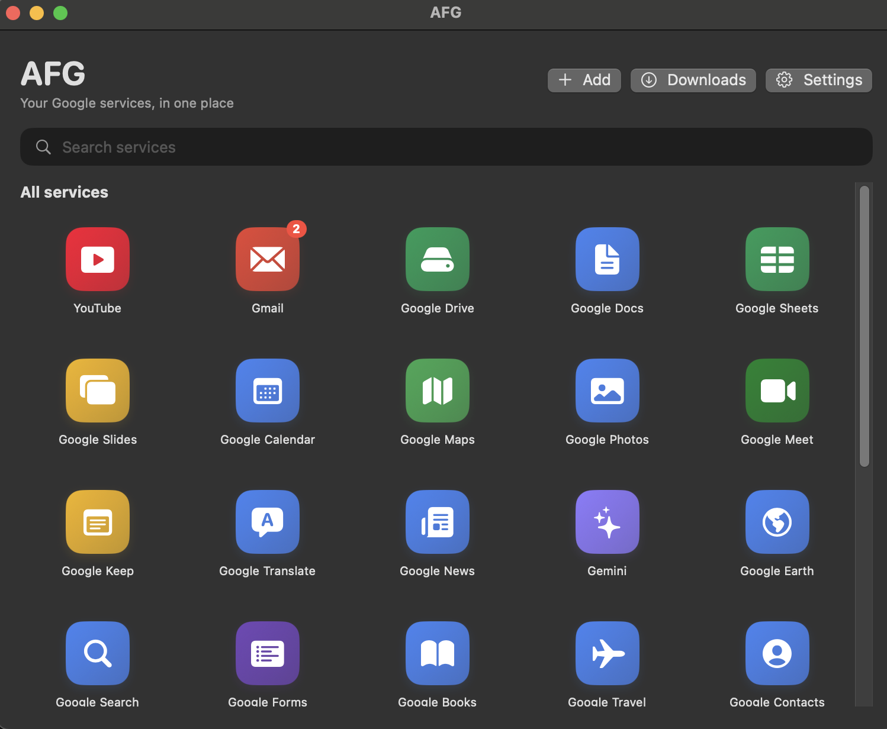
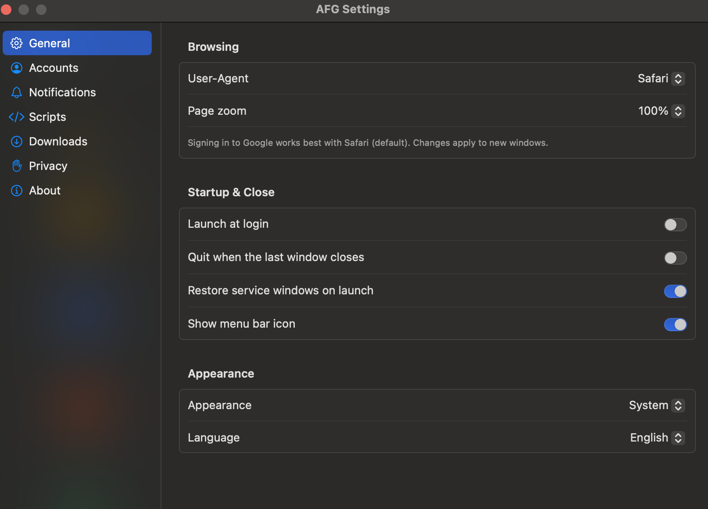

# AFG

AFG is a macOS app that runs Google web services in dedicated windows without Chrome. The interface uses SwiftUI and the pages use WebKit. macOS 15 or later is required.

English | [简体中文](README-zh.md)

<div style="display: flex; gap: 16px; align-items: flex-start;">
  
  
</div>

## Features

### Launcher

- 31 built-in services: YouTube, Gmail, Drive, Docs, Sheets, Slides, Calendar, Maps, Photos, Meet, Keep, Translate, News, Gemini, and more
- Search, pinning, and a grid layout; right-click to edit or delete custom services
- Custom web apps: name, URL, and SF Symbol. The site icon is fetched automatically for the tile.
- Right-click "Add to Launchpad" copies a launcher into `/Applications`; Launchpad picks it up automatically

### Service windows

- One window per service; WebKit persistent storage keeps the sign-in state
- Each window uses its own WebContent process pool, so a crash in one page does not affect the others
- Safari User-Agent by default, so Google does not treat the embedded WebView as an insecure browser. Docs, Sheets, and Slides use a Chrome UA so the editor canvas renders at 2x.
- Toolbar: back, forward, reload, home, always on top, print, share, downloads, open in browser
- Loading progress, title sync, window size and position restore
- Mouse-wheel scroll damping (0.5×; trackpad and nested scroll areas are unaffected)

### Accounts

- Multiple named accounts, a default account, and a per-service account (Google's `authuser` and `/u/N/`)
- The menu at the end of each account row signs out; this signs out everywhere and makes the next account the default

### Notifications and badges

- Notification permission and per-service toggles. Banners also appear in the foreground, and clicking one opens the service.
- Services with notifications enabled keep a hidden page loaded in the background, so new mail is announced even when the window is closed. Counts come from page titles; during the first 30 seconds after launch only badges update, so existing unread mail is not announced again.
- Launcher tiles show unread counts and the Dock icon shows the total. Counts come from `(N)` in page titles, decrease as mail is read, and disappear at zero.
- Opening a service adds its own Dock icon (an `AFGIconHost` process), which disappears when the window closes.

### Scripts

- Built-in scripts: generic ad hiding and YouTube ad blocking (hides ad slots, clicks skip, speeds up and mutes during ads)
- User scripts: add, edit, enable, and delete; import `.js` or JSON and export

### Other

- English and Simplified Chinese, English by default. Google pages receive the matching `hl` parameter.
- Menu bar icon, launch at login, light and dark appearance
- Downloads save to a chosen folder, with a downloads window that shows progress

## Requirements

- macOS 15 or later
- The current build is Apple Silicon (arm64)
- Swift 6 to build. Command Line Tools are enough; a full Xcode installation is not required.

## Build

```bash
make app    # build/AFG.app
make run    # build and open
make dmg    # build/AFG-v0.1.0.dmg
```

The DMG file name uses `CFBundleShortVersionString` from `Resources/Info.plist`. Bump it there and the next DMG is named automatically; `CFBundleVersion` is the build number. The app itself is always `AFG.app`.

The Makefile passes `--disable-sandbox` and keeps SwiftPM caches under `.build/` so it also works in restricted environments. A plain `swift build` works in a normal terminal.

## Packaging

### Local use

After `make app`, drag `build/AFG.app` into `/Applications`. The app is ad-hoc signed and runs locally without extra steps.

### DMG contents

`make dmg` creates a disk image containing `AFG.app` and an `Applications` shortcut. Open the image and drag the app into Applications.

## Data locations

- Preferences: `~/Library/Preferences/dev.genwilliam.afg.plist`
- Icons, user scripts, and launchers: `~/Library/Application Support/AFG/`
- Downloads: `~/Downloads` by default, configurable in Settings

## Project layout

| File                                        | Purpose                                                      |
| ------------------------------------------- | ------------------------------------------------------------ |
| `Sources/AFG/AFGApp.swift`                  | App entry, window lifecycle, defaults, URL scheme            |
| `Sources/AFG/Service.swift`                 | Service model and the 31 built-in services                   |
| `Sources/AFG/AppState.swift`                | Persistence for custom services, pins, and accounts          |
| `Sources/AFG/LauncherView.swift`            | Launcher                                                     |
| `Sources/AFG/ServiceEditor.swift`           | Add or edit a web app                                        |
| `Sources/AFG/WebWindowManager.swift`        | Service window registration and reuse                        |
| `Sources/AFG/WebWindowController.swift`     | Window, toolbar, loading, downloads, printing, always on top |
| `Sources/AFG/Downloads.swift`               | Download records and the downloads window                    |
| `Sources/AFG/OfficialScripts.swift`         | Built-in ad blocking scripts                                 |
| `Sources/AFG/UserScripts.swift`             | User script storage and editor                               |
| `Sources/AFG/ScriptSettingsSection.swift`   | Script settings page                                         |
| `Sources/AFG/AccountSettingsSection.swift`  | Account settings page                                        |
| `Sources/AFG/AccountLogoutController.swift` | Sign out of a specific Google account                        |
| `Sources/AFG/NotificationManager.swift`     | Notification permission and unread notifications             |
| `Sources/AFG/NotificationMonitor.swift`     | Background page monitor for notifications                    |
| `Sources/AFG/UnreadStore.swift`             | Unread counts and Dock badge                                 |
| `Sources/AFG/SettingsView.swift`            | Settings window                                              |
| `Sources/AFG/StatusBarController.swift`     | Menu bar                                                     |
| `Sources/AFG/LoginItem.swift`               | Launch at login                                              |
| `Sources/AFG/Localization.swift`            | English and Chinese strings                                  |
| `Sources/AFG/Prefs.swift`                   | Preference keys and defaults                                 |
| `Sources/AFG/ServiceDockIcon.swift`         | Service Dock icon host                                       |
| `Sources/AFG/ServiceIconRenderer.swift`     | Tile-style icon rendering                                    |
| `Sources/AFG/DockLauncher.swift`            | Launcher for dragging to the Dock                            |
| `Sources/AFG/LaunchpadInstaller.swift`      | Add to Launchpad                                             |
| `Sources/AFG/ScrollDamping.swift`           | Scroll damping script                                        |
| `Sources/AFGIconHost/main.swift`            | Icon host process                                            |
